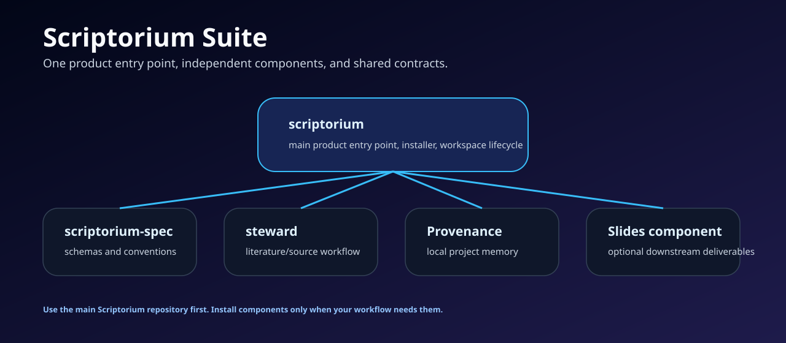

# Scriptorium Suite

## Repository and version navigation

[Version guide: published baselines, development lines and historical archives](https://github.com/scriptorium-suite/scriptorium/blob/main/VERSION_GUIDE.md)

- **Public entry point:** [Scriptorium](https://github.com/scriptorium-suite/scriptorium), published baseline v0.2.0.
- **Components:** [Spec](https://github.com/scriptorium-suite/scriptorium-spec), [Provenance and Capture](https://github.com/foxsplendid/Provenance), [Steward](https://github.com/scriptorium-suite/steward), and [Lectern](https://github.com/foxsplendid/Academic-Slides-Agent).
- **Experimental work:** evidence-loop and evidence-contract development branches, plus Lectern's Windows handoff candidate. These are unreleased.
- **Historical snapshots:** `archive/2026-11-06/` tags preserve prior publishing and candidate states; the unmerged Spec candidate branch is retained.
- **Retired references:** [Engram](https://github.com/foxsplendid/Engram) and [PPT-Agent](https://github.com/foxsplendid/PPT-Agent).

Scriptorium Suite is a local-first toolkit for long-running work with AI agents. It helps users keep project goals, sources, sessions, decisions, evidence, and deliverables in a recoverable local workspace instead of scattering them across chats and folders.

## Start here

The main product entry point is [scriptorium](https://github.com/scriptorium-suite/scriptorium). Start there if you want to try the suite, understand the current stable workflow, or evaluate the project as a public product.

The suite is intentionally modular. Components remain independently usable, but they share file contracts so they can work together when installed through Scriptorium.

| Repository | Role |
| --- | --- |
| [scriptorium](https://github.com/scriptorium-suite/scriptorium) | Main entry point, installer, workspace lifecycle, status, and resume commands. |
| [scriptorium-spec](https://github.com/scriptorium-suite/scriptorium-spec) | Shared JSON Schemas, examples, and conventions for suite interoperability. |
| [steward](https://github.com/scriptorium-suite/steward) | Literature and source workflow component for reference-library governance and handoff files. |
| [Provenance](https://github.com/foxsplendid/Provenance) | Local project memory, ingestion, search, context capsules, MCP, and reviewable writeback. |
| [Academic-Slides-Agent](https://github.com/foxsplendid/Academic-Slides-Agent) | Optional presentation and reporting component direction. |

## Current product boundary

The current public release focuses on the reliable front half of the workflow: initialize a project workspace, inventory and migrate selected local material, install compatible components, and resume future AI sessions from bounded project context.

Evidence promotion, execution loops, and slide generation are active directions, but they are not required to understand or use the current stable release.

## Design principles

- Local-first by default.
- Model-neutral: agents are clients, not the owner of project state.
- File contracts over private component APIs.
- Raw sources, AI drafts, execution facts, and user-reviewed claims stay separate.
- Components can be used alone or through the suite entry point.

## Public release posture

The public examples are synthetic and scrubbed. Private research material, personal memory, credentials, and local-only archives should not be committed to public repositories.

See the main repository for installation and verification instructions:

[github.com/scriptorium-suite/scriptorium](https://github.com/scriptorium-suite/scriptorium)
